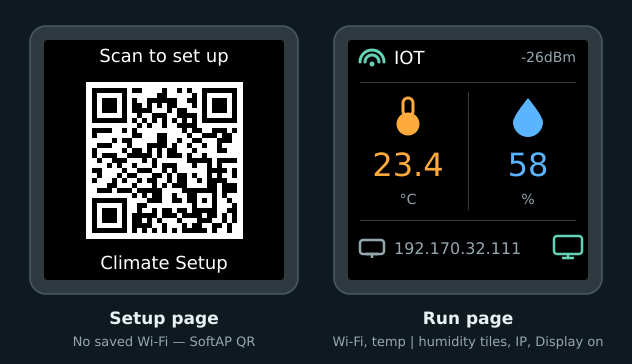

# Display

The **240×240** ST7789 needs a SPI bus, a backlight, fonts, a QR payload, and two pages. Home Assistant gets a **Display** switch to turn the panel on or off.



*Mock-up from the display code: SoftAP QR, then Wi‑Fi status, side-by-side temp / humidity tiles, IP, and a display-on cue.*

## Pins

| Signal | GPIO | Set in | Wired in |
|--------|------|--------|----------|
| SCK / SCL | **12** | `spi` | [Display](../03-wire/display.md) (checkpoint 4) |
| MOSI / SDA | **11** | `spi` | same |
| CS | **10** | `display` | same |
| DC | **9** | `display` | same |
| RST | **7** | `display` | same |
| BL | **21** | `output` | same |

Silk on the module may say `SCL` or `SCK` for the clock — same net.

## SPI bus

```yaml
spi:
  clk_pin: GPIO12
  mosi_pin: GPIO11
```

## Backlight and Display switch

```yaml
output:
  - platform: ledc
    id: backlight_pwm
    pin: GPIO21

light:
  - platform: monochromatic
    id: backlight
    output: backlight_pwm
    internal: true
    restore_mode: ALWAYS_OFF

switch:
  - platform: template
    name: Display
    id: tft_enable
    icon: mdi:monitor
    optimistic: true
    restore_mode: RESTORE_DEFAULT_ON
    turn_on_action:
      - light.turn_on:
          id: backlight
          brightness: 100%
    turn_off_action:
      - light.turn_off: backlight
```

| Key | What it does |
|-----|--------------|
| `ledc` output | PWM on GPIO21 for the backlight |
| `light` (internal) | Drives brightness; not shown in Home Assistant |
| `switch` **Display** | On/off in Home Assistant — turns the TFT backlight fully on or off |
| `RESTORE_DEFAULT_ON` | Remembers the last Display state; defaults to on |

## Fonts and QR

```yaml
font:
  - file: "gfonts://Roboto@500"
    id: font_big
    size: 36
  - file: "gfonts://Roboto"
    id: font_text
    size: 18

qr_code:
  - id: setup_qr
    value: "WIFI:S:${ap_ssid};T:WPA;P:${ap_password};;"
```

| Piece | Role |
|-------|------|
| `font_big` (36) | Temperature and humidity values |
| `font_text` (18) | Labels and SSID / IP |
| `font_mdi` / `font_mdi_lg` | Material Design Icons (status row + large climate icons) |
| `setup_qr` | Standard Wi‑Fi QR from the same `ap_ssid` / `ap_password` as the hotspot |

Roboto is downloaded at compile time (needs internet once), then baked into the firmware.

## Pages

`page_setup` draws the SoftAP QR. `page_run` is the connected dashboard — Wi‑Fi strength, two climate tiles (thermometer / humidity), IP, and a monitor icon that matches the **Display** switch when the panel is on. Full lambdas live in `firmware/climate.yaml`.

| Setting | What it does |
|---------|--------------|
| `update_interval: 2s` | Redraw every two seconds |
| `invert_colors: true` | Matches this 240×240 module — flip if colours look wrong |
| First page in the list | Default is readings; boot logic shows QR only when no home Wi‑Fi is saved |
| `wifi_info` text sensors | Feed SSID and IP into `page_run` |
| `wifi_signal` | Feeds dBm and picks the strength icon |

| Page | Draws |
|------|-------|
| `page_setup` | QR icon, "Scan to set up", SoftAP QR, hotspot name |
| `page_run` | Wi‑Fi strength + SSID + dBm; temp \| humidity tiles; IP + display-on icon |

[Wi‑Fi setup](wifi.md) chooses the page at boot and on connect / disconnect (QR only when unprovisioned).

**Next:** [Factory reset](reset.md)
