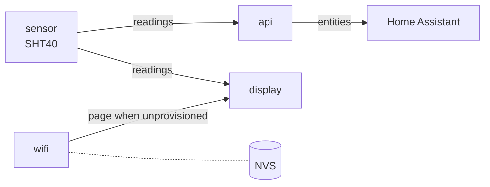

# 1. Walk through the code

The firmware is one [ESPHome](https://esphome.io) file: [`firmware/climate.yaml`](https://github.com/jajera/esp32-s3-ha-climate/blob/main/firmware/climate.yaml). You describe the hardware and behaviour in YAML; ESPHome turns that into firmware.

You don't need to memorise the file. The point is to know which block to open when you want to change something.

## How the pieces connect

The display defaults to readings. The QR setup page appears only when no home Wi‑Fi is saved yet (first boot or after factory reset). A short drop keeps the readings page and turns the Wi‑Fi icon off. The dotted line is where the chip stores your home Wi‑Fi details (NVS), never this file.

## The blocks

- :lucide-cpu: **[ESP32](board.md)**

    `substitutions` `esphome` `esp32` `psram` `logger`

- :brands-home-assistant:{ .lg .middle } **[Home Assistant](home-assistant.md)**

    `api` `ota` `dashboard_import`

- :lucide-wifi: **[Wi‑Fi setup](wifi.md)**

    `wifi` `captive_portal` (+ Improv in YAML, not walked through)

- :lucide-thermometer: **[Sensors](sensors.md)**

    `i2c` `sensor`

- :lucide-monitor: **[Display](display.md)**

    `spi` `output` `light` `switch` `font` `qr_code` `display`

- :lucide-rotate-ccw: **[Factory reset](reset.md)**

    `button` `binary_sensor`

## Where to change things

| If you want to change… | Open |
|------------------------|------|
| Setup hotspot name or password | [ESP32](board.md) → `substitutions` |
| How often the sensor reads | [Sensors](sensors.md) → `update_interval` |
| Screen colours, layout or text | [Display](display.md) → `pages` |
| Which pins are used | [Sensors](sensors.md) / [Display](display.md) (same pins as [Wire](../03-wire/index.md)) |
| Reset hold time | [Factory reset](reset.md) → `binary_sensor` |

**Next:** [ESP32](board.md)
