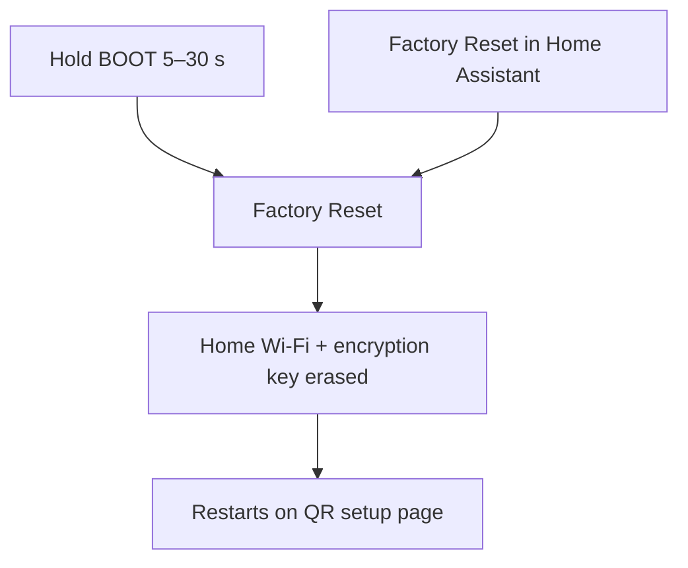

# Factory reset

Two Home Assistant buttons, plus a long-press on the board's **BOOT** button.

```yaml
button:
  - platform: factory_reset
    id: factory_reset_btn
    name: Factory Reset

  - platform: restart
    name: Restart

binary_sensor:
  - platform: gpio
    id: boot_btn
    internal: true
    pin:
      number: GPIO0
      mode: INPUT_PULLUP
      inverted: true
      ignore_strapping_warning: true
    on_click:
      - min_length: 5s
        max_length: 30s
        then:
          - button.press: factory_reset_btn
```

## What reset does



| Button | Effect |
|--------|--------|
| **Factory Reset** | Clears saved home Wi‑Fi and the encryption key, then restarts |
| **Restart** | Reboots without wiping settings |

The firmware binary stays. After reset you're back on the setup hotspot from `ap_ssid` / `ap_password`, and the screen shows the SoftAP QR again. A plain **RST** or power-cycle does **not** wipe prefs and should not show the QR once Wi‑Fi is saved. How to test it is in [Configure and test](../05-configure-and-test.md).

## BOOT hold times

GPIO0 is the board **BOOT** button. Don't wire anything else to it ([ESP32 wiring](../03-wire/esp32.md)).

| Hold | Result |
|------|--------|
| Under 5 s | Nothing (avoids accidental wipes) |
| 5–30 s | Presses Factory Reset when you let go |
| Over 30 s | Nothing |

| Key | Why |
|-----|-----|
| `inverted: true` | Button pulls the pin low when pressed |
| `internal: true` | Hidden from Home Assistant — it only triggers reset |
| `ignore_strapping_warning: true` | GPIO0 is also a boot strapping pin; this silences ESPHome's warning |

## Check your edits

After you change the YAML, validate it without building:

<div class="run" markdown>

```bash
.venv/bin/esphome config firmware/climate.yaml | grep INFO
```

```text {.no-copy}
INFO ESPHome 2026.10.2
INFO Reading configuration firmware/climate.yaml...
INFO Configuration is valid!
```

</div>

Needs [ESPHome installed](../02-build-image.md). Errors name the block and line (for example an `ap_password` shorter than 8 characters).

**Next:** [Build the image](../02-build-image.md)
