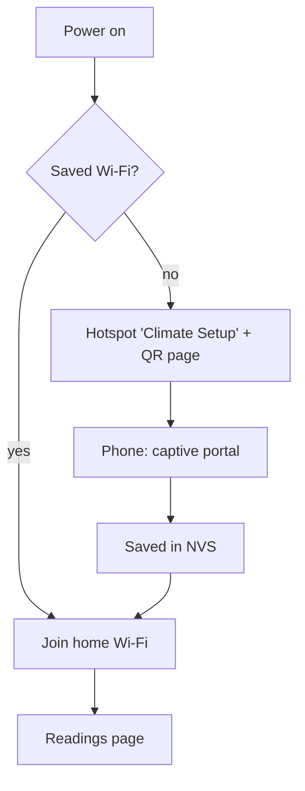

# Wi‑Fi setup

No home Wi‑Fi password is in the file. The device starts its own setup hotspot; this tutorial uses the SoftAP QR and captive portal on your phone.

```yaml
esphome:
  # …name / project…
  on_boot:
    priority: -100
    then:
      - if:
          condition:
            lambda: return !wifi::global_wifi_component->has_sta();
          then:
            - display.page.show: page_setup

wifi:
  ap:
    ssid: ${ap_ssid}
    password: ${ap_password}
  on_connect:
    - display.page.show: page_run
  on_disconnect:
    - if:
        condition:
          lambda: return !wifi::global_wifi_component->has_sta();
        then:
          - display.page.show: page_setup

captive_portal:

improv_ble:
  authorizer: none

improv_serial:
```

Boot defaults to the readings page. The late `on_boot` check (after Wi‑Fi has loaded NVS) switches to the QR only when nothing is saved yet.

## First boot



Until something is saved, the device broadcasts `Climate Setup` with password `setup1234`. Scan the QR, join the hotspot, pick your home network, and save. Details are stored in NVS and survive reboots. The phone steps are in [Configure and test](../05-configure-and-test.md).

| Component | Role in this tutorial |
|-----------|------------------------|
| `captive_portal` | SoftAP web page after you join **Climate Setup** — the path we document and test |
| `improv_ble` / `improv_serial` | Still in the YAML for ESPHome compatibility; **not** covered further here |

!!! note "Improv left in firmware only"
    `improv_ble` and `improv_serial` stay enabled so the binary matches common ESPHome onboarding, but this guide does not walk through Bluetooth or browser-over-USB setup. Use the QR + captive portal path above.

## Switching screens

| Event | Screen |
|-------|--------|
| Boot with saved Wi‑Fi | Readings (`page_run`) |
| Boot with no saved Wi‑Fi | QR setup (`page_setup`) |
| `on_connect` | Readings (`page_run`) |
| `on_disconnect` (prefs cleared) | QR setup (`page_setup`) |
| `on_disconnect` (home Wi‑Fi still saved) | Stay on readings — Wi‑Fi icon goes off |

RST / power-cycle after setup should **not** flash the QR. The QR returns after a [factory reset](reset.md). Both pages are drawn in [Display](display.md).

**Next:** [Sensors](sensors.md)
