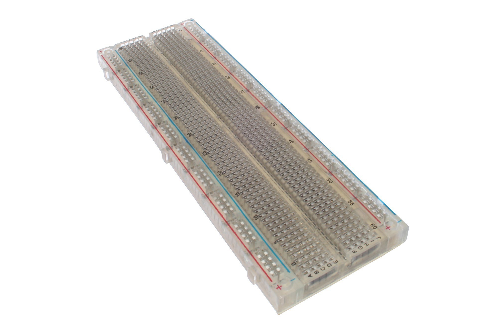
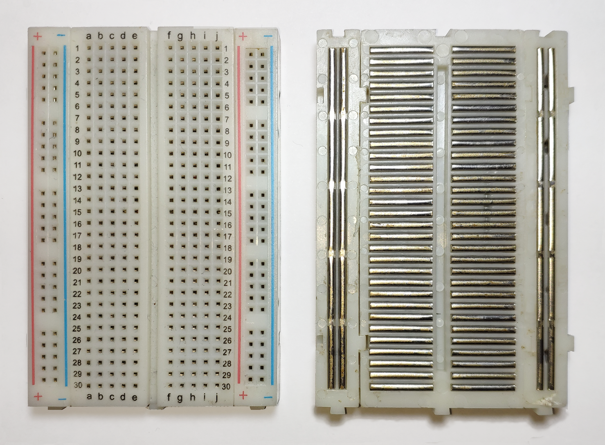

# Breadboard

Nothing is wired yet. The plastic board already has metal clips under the holes — those clips decide what is connected. Learn that map before you seat any jumpers.

!!! note "Before you start"
    Parts from the [overview](index.md) on the desk. Breadboard empty. No jumpers seated yet.

## 1. Look at your board

*A typical full-size board. Yours may be half-size (400 holes) or full-size (830). The rules below are the same.*

Find these three things on yours:

| What | Where |
|------|-------|
| Centre trench | The groove down the middle |
| Letter columns | `a–e` on one side of the trench, `f–j` on the other |
| Power rails | The long `+` (often red) and `−` (often blue) columns along the edge |

## 2. What's already connected

Pull the sticky backing off a spare board once in your life and the clips look like this. You don't need to strip yours — the photo is enough.

*Left: top. Right: metal clips underneath. Short clips = rows of five. Long clips = power rails.*

| Region | How the holes are tied |
|--------|------------------------|
| Terminal strips | Each **numbered row** of five (`a–e` **or** `f–j`) is one net. Same number across the trench is **not** joined |
| Power rails | Each `+` column is one long net. Each `−` column is another |
| Rail gaps | Many boards break each rail halfway. A short jumper across the gap joins the two halves |

## 3. Pick the rails for this project

Choose **one** `+` rail and **one** `−` rail. Later steps put **3V3** on `+` and **GND** on `−`, then every module takes power from those rails.

If your rails split in the middle, put a short jumper across each gap now so the whole rail is one continuous net.

## Check

- You can point to your chosen `+` and `−` rails
- You know a pin in `a1` does **not** connect to `f1` (trench in between)
- Mid-rail gaps are bridged, or you confirmed your board has continuous rails

## If it fails

| Symptom | Fix |
|---------|-----|
| Two parts share a row number but don't talk | They're on opposite sides of the trench. Jump across, or move both to the same side |
| Only half the rail has power later | Mid-rail gap. Bridge it with a short jumper |

<small>Credit: empty board [oomlout](https://commons.wikimedia.org/wiki/File:BREB-02_(14335226011).jpg) (CC BY-SA 2.0); connections photo [Guhuru](https://commons.wikimedia.org/wiki/File:Breadboard.png) (CC0).</small>

## Checkpoint 1

- [ ] I can point to the `+` rail and the `−` rail I'll use for 3V3 and GND
- [ ] I know the left and right halves of a row are **not** connected
- [ ] Mid-rail gaps are bridged, or my rails are continuous

**Stop here until every box is ticked.**

**Next:** [ESP32](esp32.md)
