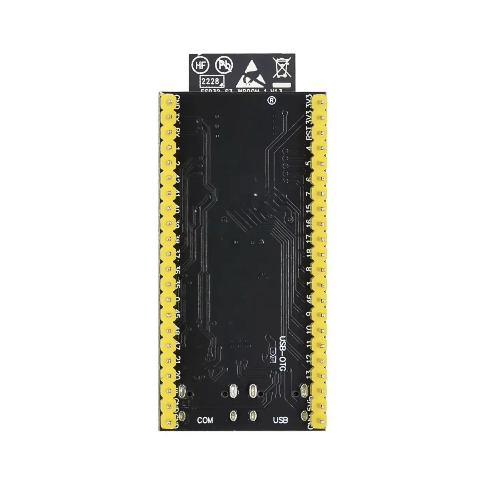

# ESP32

Put the ESP32-S3 on the breadboard and feed the `+` and `−` rails from it. Later steps take power from those rails.

!!! note "Before you start"
    [Checkpoint 1](breadboard.md) passed. USB unplugged while you seat jumpers.

Match pins by **silk label**, not by position. The underside silk is mirrored compared with the top.



## Wires

| | From ESP32 | To breadboard |
|---|------------|---------------|
| :lucide-plus: | **3V3** | `+` rail |
| :lucide-minus: | **GND** | `−` rail |

If your rails split in the middle, bridge each gap with a short jumper.

!!! warning
    Don't power the sensor or display from **5V** or **VIN**.

## Leave these pins free

| | Pin | Why |
|---|-----|-----|
| :lucide-rotate-ccw: | **GPIO0** | The **BOOT** button, used for the factory reset |
| :lucide-usb: | GPIO19 / 20 | Native USB |
| :lucide-memory-stick: | GPIO35–37 | PSRAM |
| :lucide-triangle-alert: | GPIO45 / 46 | Strapping pins |

## Check

Plug a USB-C **data** cable into the port labelled **COM**, then run:

<div class="run" markdown>

```bash
lsusb | grep -iE '1a86|QinHeng'
ls -l /dev/ttyACM0 /dev/ttyUSB0 2>/dev/null
```

```text {.no-copy}
Bus 001 Device 015: ID 1a86:55d3 QinHeng Electronics USB Single Serial
crw-rw-rw- 1 root dialout 166, 0 Nov 10 22:12 /dev/ttyACM0
```

</div>

The **COM** socket appears as a QinHeng serial bridge (`1a86`), not as an Espressif device. If `lsusb` shows Espressif (`303a`) instead, the cable is in the native **USB** socket. Move it to **COM**.

The device number and date will differ on your machine. Nothing on the board should get warm. Unplug before the next step.

## If it fails

| Symptom | Fix |
|---------|-----|
| No `/dev/ttyACM0` | Try another **data** cable, and check it is in the **COM** socket, not **USB** |
| Board warm | Unplug. 3V3 and GND may be swapped or shorted on the rail |
| A meter on the `+` rail reads 5 V instead of about 3.3 V | The rail is fed from the wrong pin. Move the wire to **3V3** |

## Checkpoint 2

- [ ] Only **3V3** to `+` and **GND** to `−` from the ESP32 (no sensor or display wires yet)
- [ ] Rail gaps bridged, if your board has them
- [ ] The board shows up in `lsusb` and as `/dev/ttyACM0`
- [ ] The board stays cool

**Stop here until every box is ticked.**

**Next:** [SHT40](sht40.md)
