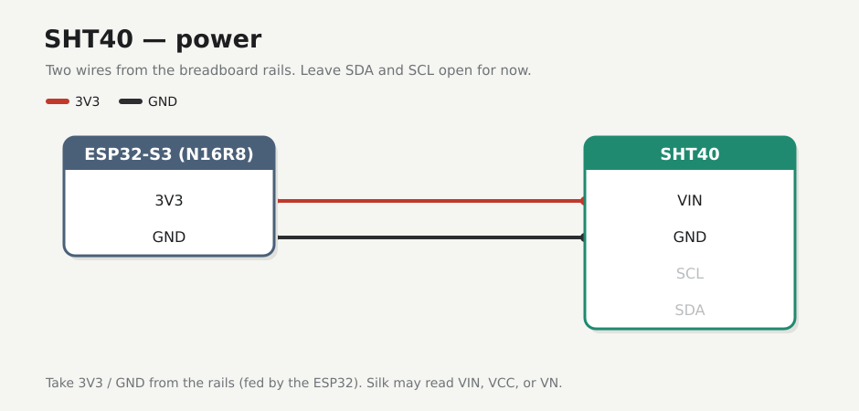
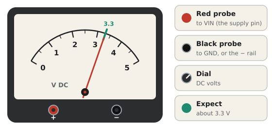
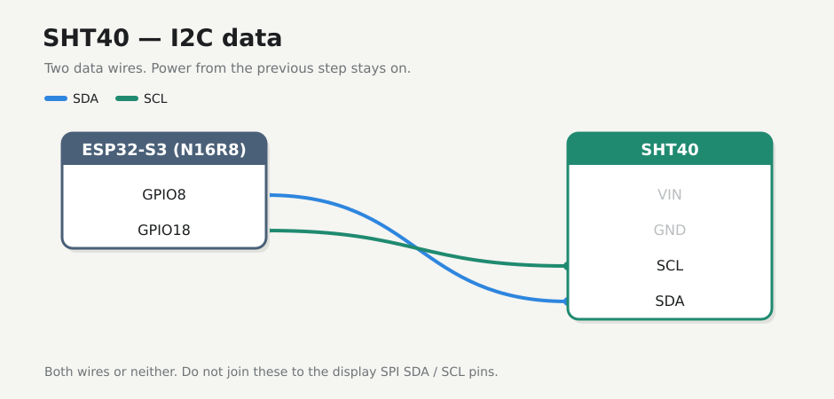

# SHT40

Temperature and humidity over I2C, at address **0x44**. Power first, then the two data wires.

!!! note "Before you start"
    [Checkpoint 2](esp32.md) passed. USB unplugged while you seat jumpers.

!!! warning
    Power from **3V3 only**. After wiring, check for heat and, if you have a meter, about 3.3 V on the supply pin.

The power pin may be printed **VIN**, **VCC** or **VN**. They all go to the 3V3 rail.

## 1. Power

| | From | To |
|---|------|----|
| :lucide-plus: | `+` rail (3V3) | SHT40 **VIN** / **VCC** / **VN** |
| :lucide-minus: | `−` rail (GND) | SHT40 **GND** |

Leave **SDA** and **SCL** open for now. Plug into **COM** and check that the module is cool. If you have a meter, expect about **3.3 V** on the supply pin (optional):

{ .meter }

Unplug before adding the data wires.

## 2. I2C

| | ESP32 | SHT40 |
|---|-------|-------|
| :lucide-arrow-right-left: | **GPIO8** | **SDA** |
| :lucide-clock: | **GPIO18** | **SCL** |

Both wires or neither. One alone will fail the later scan at `0x44`.

!!! warning "Keep the buses apart"
    Do **not** join these to the display's `SDA` and `SCL` pins. Those are SPI.

## If it fails

| Symptom | Fix |
|---------|-----|
| Module warm | Unplug. Check that VIN isn't on 5V and GND is on the `−` rail |
| Meter doesn't read about 3.3 V | Confirm the ESP32 still feeds the `+` rail ([checkpoint 2](esp32.md)) |
| Flashing later shows no `0x44` | Come back here. Check SDA and SCL aren't swapped, reseat both data jumpers, and shorten the wires |

## Checkpoint 3

- [ ] SHT40 power is on 3V3 and GND only, taken from the breadboard rails (not daisy-chained off the display)
- [ ] GPIO8 to SDA and GPIO18 to SCL, both seated
- [ ] The module stays cool with **COM** plugged in (and about 3.3 V on the supply pin, if metered)
- [ ] No wires on the display yet

**Stop here until every box is ticked.**

**Next:** [Display](display.md)
