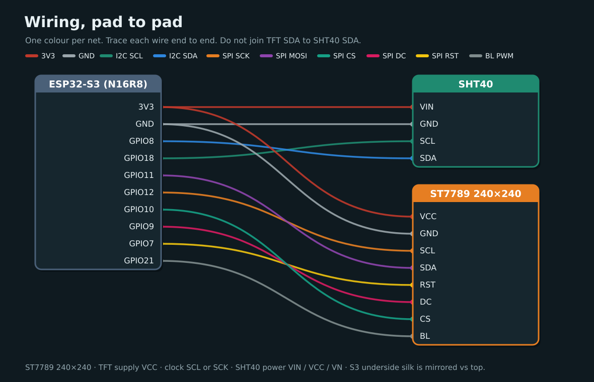

# Validate

Walk the full pin map and confirm USB still works. Do not expect the display to light or the SHT40 to report values here — that comes after you [flash](../04-flash-esp32.md).

!!! note "Before you start"
    [Checkpoint 4](display.md) passed. Everything from the earlier steps stays wired.



## The full map

| ESP32-S3 | SHT40 | Display (ST7789) |
|----------|-------|------------------|
| **3V3** | VIN / VCC / VN | VCC |
| **GND** | GND | GND |
| **GPIO8** | SDA | |
| **GPIO18** | SCL | |
| **GPIO11** | | SDA (MOSI) |
| **GPIO12** | | SCL / SCK |
| **GPIO10** | | CS |
| **GPIO9** | | DC |
| **GPIO7** | | RST |
| **GPIO21** | | BL |

## Rules

- **3V3 only** for sensor and display logic.
- Do not join TFT SDA to SHT40 SDA.
- Avoid GPIO **0 / 19 / 20 / 45 / 46** (and **35–37** on octal PSRAM) for new wires — **BOOT** already uses GPIO0.
- S3 underside silk is mirrored vs top — match by **label**.

## Check

| | Check | What to look for |
|---|-------|------------------|
| :lucide-list-checks: | Walk the map | Every row above has a jumper on the matching pin label |
| :lucide-split: | Two separate buses | SHT40 uses GPIO8 and 18. Display SDA/SCL use GPIO11 and 12 and never share a wire with them |
| :lucide-zap: | 3V3 only | No sensor or display pin is on 5V or VIN |
| :lucide-hand: | Cool | After a few seconds on **COM**, lightly touch the SHT40 and the display. If anything is warm, unplug and recheck power and ground |
| :lucide-usb: | USB | Data cable in the **COM** socket. Run the commands below |

<div class="run" markdown>

```bash
lsusb | grep -iE '1a86|QinHeng'
ls -l /dev/ttyACM0 /dev/ttyUSB0 2>/dev/null
```

```text {.no-copy}
Bus 001 Device 015: ID 1a86:55d3 QinHeng Electronics USB Single Serial
crw-rw-rw- 1 root dialout 166, 0 Nov 10 22:12 /dev/ttyACM0
```

</div>

Expect the QinHeng serial bridge (`1a86`) and a port such as `/dev/ttyACM0`. The panel may stay dark. I2C at `0x44`, backlight, and the setup QR are checked on [Flash](../04-flash-esp32.md).

## If it fails

| Symptom | Likely fix |
|---------|------------|
| No serial port | Use a **data** cable in the **COM** socket (not native USB). USB group setup is in [Flash](../04-flash-esp32.md) |
| Something warm | Unplug. Start at 3V3 and GND, then the last wires you added |
| The map doesn't match | One jumper is on the wrong pin. Walk the table row by row |

## Checkpoint 5

- [ ] The full map matches the table above
- [ ] The I2C and SPI buses are not crossed
- [ ] The board shows up on USB (`lsusb` and a serial device)
- [ ] The SHT40 and display stay cool

**Stop here until every box is ticked.**

**Next:** [Flash the ESP32](../04-flash-esp32.md)
