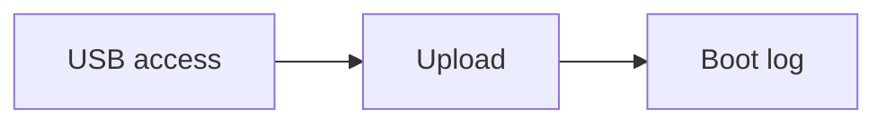

# 4. Flash the ESP32

Give your user access to the USB serial port, upload the firmware you built, and confirm the device boots cleanly.

!!! note "Before you start"
    You passed [checkpoint 5](03-wire/validate.md), the board is on the **COM** socket with a data cable, and you built the firmware in [step 2](02-build-image.md). Upload needs that build.



## Allow USB access

Linux only lets members of the `dialout` group use serial ports. Run the setup script once. It installs the udev rules and adds you to the group:

<div class="run" markdown>

```bash
sudo ./scripts/setup-linux-usb.sh
```

```text {.no-copy}
Installing udev rules → /etc/udev/rules.d/99-platformio-udev.rules
Reloading udev
Adding johna to group dialout

Setup complete.
…
```

</div>

The script then lists what to do next. **Log out and back in** so the new group applies, then unplug and replug the board (**COM** socket, data cable). Check both:

<div class="run" markdown>

```bash
groups | grep -o dialout
ls -l /dev/ttyACM0
```

```text {.no-copy}
dialout
crw-rw-rw- 1 root dialout 166, 0 Nov 10 23:35 /dev/ttyACM0
```

</div>

No `/dev/ttyACM0`? Go back to [Validate](03-wire/validate.md) and recheck the cable and the USB socket.

## Upload

<div class="run" markdown>

```bash
.venv/bin/esphome upload firmware/climate.yaml --device /dev/ttyACM0
```

```text {.no-copy}
…
Connected to ESP32-S3 on /dev/ttyACM0:
Chip type:          ESP32-S3 (QFN56) (revision v0.2)
…
Wrote 1378256 bytes (891760 compressed) at 0x00000000 in 21.5 seconds (513.6 kbit/s).
Verifying written data...
Hash of data verified.
Hard resetting via RTS pin...
INFO Successfully uploaded program.
```

</div>

This writes the complete `firmware.factory.bin` from the build step to the board.

!!! tip "Stuck on `Connecting...`?"
    Hold **BOOT**, tap **RST** (some boards label it **EN**), release **BOOT**, then run the command again.

## Watch it boot

<div class="run" markdown>

```bash
.venv/bin/esphome logs firmware/climate.yaml --device /dev/ttyACM0
```

```text {.no-copy}
…
[I][logger:136]: Log initialized
[I][app:073]: Running through setup()
[D][sht4x:027]: Serial number: 175cd736
…
[C][wifi:1075]:   AP SSID: 'Climate Setup'
[C][wifi:1075]:   AP Password: 'setup1234'
[I][app:130]: setup() finished successfully!
…
[C][logger:225]:   Hardware UART: UART0
…
[C][i2c:119]: Found device at address 0x44
…
[C][sht4x:072]:   Address: 0x44
[C][qr_code:011]:   Value: 'WIFI:S:Climate Setup;T:WPA;P:setup1234;;'
[C][display.mipi_spi:010]:   Model: ST7789V
…
```

</div>

Press `Ctrl+C` when you have enough. Check:

| | Look for | If it's wrong |
|---|----------|---------------|
| :lucide-rotate-ccw: | The log doesn't restart from the top over and over | A reboot loop usually means a wiring short or bad power. Unplug and recheck the wiring |
| :lucide-scan-search: | `Found device at address 0x44` | That's the SHT40. If it's missing, recheck SDA and SCL on the [SHT40](03-wire/sht40.md) page |
| :lucide-wifi: | SoftAP `Climate Setup` | Wi‑Fi stack failed to start — uncommon; power-cycle and watch the log again |
| :lucide-lightbulb: | The display backlight is on | Recheck **BL → GPIO21** and **VCC → 3V3** on the [Display](03-wire/display.md) page |
| :lucide-qr-code: | The screen shows **Scan to set up** with a QR code | Backlight on but blank: recheck the five SPI wires (CS, DC, RST, SCL, SDA). Colours inverted: see below |

Screen states after Wi‑Fi and in Home Assistant are covered in [Configure and test](05-configure-and-test.md).

!!! tip "Colours look inverted?"
    That's the firmware, not the wiring. Change `invert_colors: true` to `false` in `firmware/climate.yaml`, build again and upload again.

!!! success "Done when"
    - `esphome upload` ends with **Successfully uploaded program.**
    - The log shows the SHT40 at `0x44` and SoftAP `Climate Setup`
    - The backlight is on and the screen shows **Scan to set up** with the QR code

**Next:** [Configure and test](05-configure-and-test.md)
