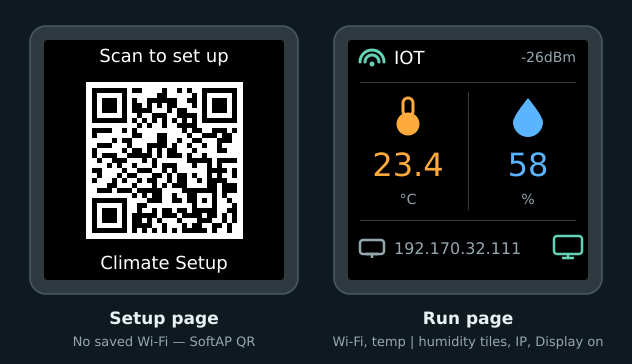
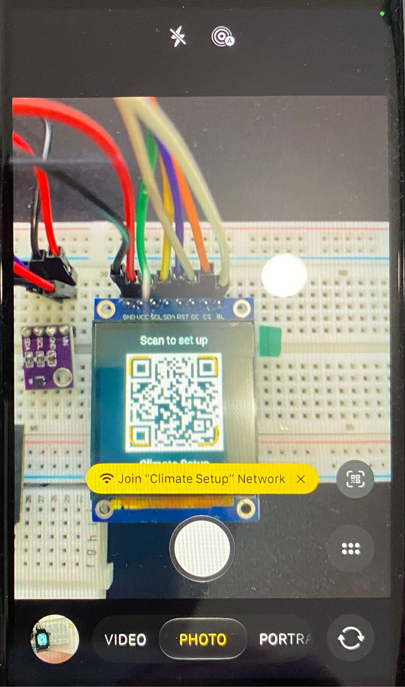
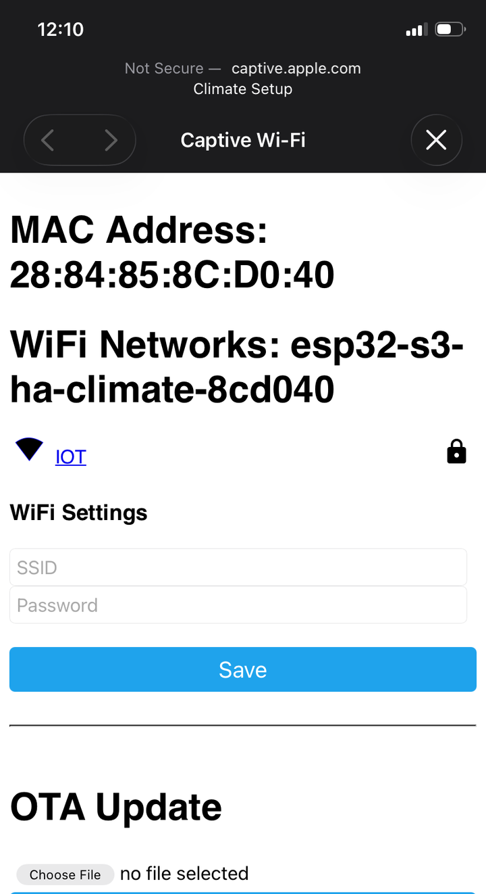
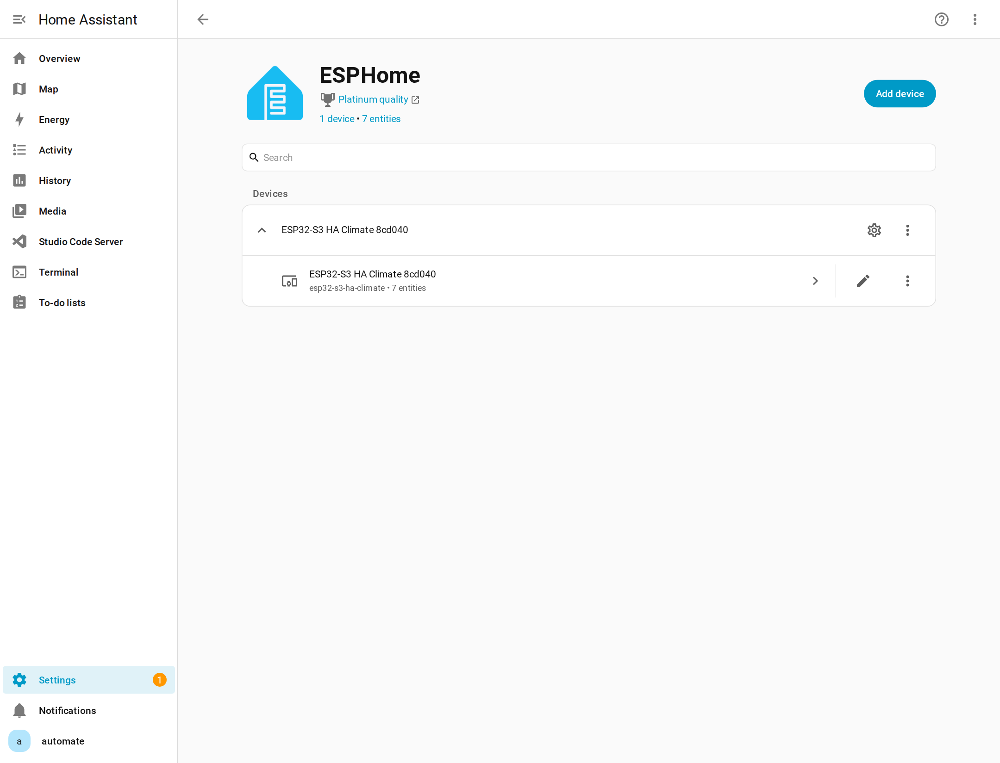
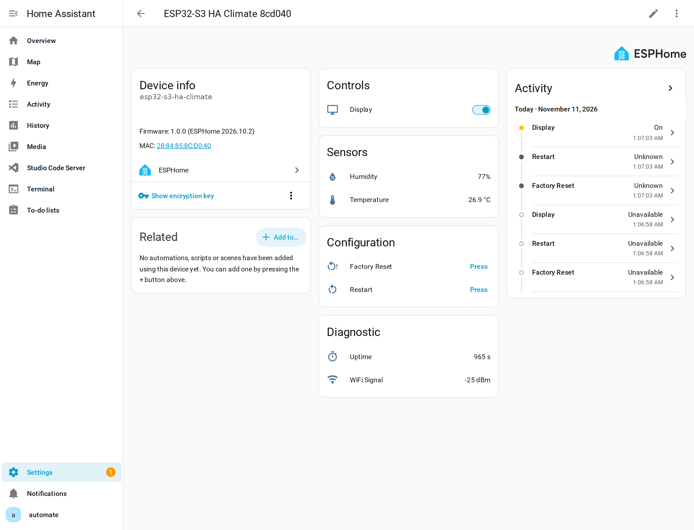
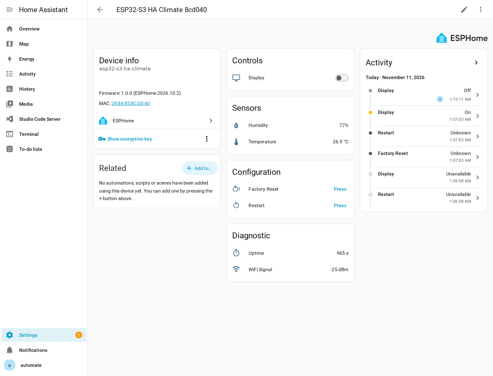

# 5. Configure and test

Get the device onto your Wi‑Fi, add it to Home Assistant, and check that the settings stick and that the reset works.

## What the screen shows



*TFT layout from the firmware (no separate desk photo). Left: SoftAP QR. Right: run page — Wi‑Fi status, temp \| humidity tiles, IP, Display-on cue. Live HA readings appear in the device-page screenshot below.*

## Connect to your Wi‑Fi {#connect-wifi}

While the device has no saved network, the screen shows a QR code and the device broadcasts its own hotspot:

| Setting | Value |
|---------|-------|
| Hotspot name | `Climate Setup` |
| Hotspot password | `setup1234` |

### From your phone (QR code)

1. Point your phone camera at the QR code on the screen and tap the Wi‑Fi prompt to join **Climate Setup**.



*Scan the on-screen QR — the phone offers **Join "Climate Setup" Network**.*

2. A setup page opens automatically. If it doesn't, open `http://192.168.4.1` in the browser.



*Captive portal — pick your home SSID (for example **IOT**), enter the password, and tap **Save**.*

3. After **Save**, wait for the device to join your network. SoftAP turns off and the screen switches to the readings page (Wi‑Fi status, temp \| humidity tiles, IP).

After a successful join, the serial log looks like this (SSID and IP will differ on your network):

<div class="run" markdown>

```bash
.venv/bin/esphome logs firmware/climate.yaml --device /dev/ttyACM0
```

```text {.no-copy}
…
[D][wifi:708]: Loaded settings: IOT
…
[I][wifi:1588]: - 'IOT' … Ch: 8 -26dB
[I][wifi:1250]: Connecting to 'IOT' …
[I][wifi:1732]: Connected
[D][wifi:1127]: Disabling AP
[C][wifi:1392]:   IP Address: 192.170.32.111
[C][wifi:1403]:   SSID: 'IOT'
  Hostname: 'esp32-s3-ha-climate-8cd040'
  Signal strength: -26 dB
…
```

</div>

!!! note "Other onboarding (not in this guide)"
    The firmware also enables Improv over BLE and serial. This tutorial only documents the QR + captive portal path above.

## Add it to Home Assistant

Once the device is on your network, Home Assistant normally finds it by itself:

1. Go to **Settings → Devices & services**. A discovered **ESPHome** device appears at the top.
2. Click **Add** and confirm. Home Assistant sets the device's encryption key as it adds it.
3. Open the device page. You should see **Temperature**, **Humidity**, **Display**, **Factory Reset**, and **Restart**, plus Wi‑Fi signal and uptime under Diagnostic.

If nothing is discovered, add the **ESPHome** integration manually:

| Field | Value |
|-------|-------|
| Host | the device IP (from the log or your router), e.g. `192.170.32.111` |
| Port | **6053** |



*ESPHome after adopt — one device, seven entities.*



*Device page: **Display** switch, temperature / humidity, Factory Reset / Restart, Wi‑Fi signal and uptime.*

When Home Assistant is connected, the serial log shows an API client (your IP will differ):

```text {.no-copy}
[D][api.connection:2816]: aioesphomeapi (192.169.…
```

## Test it

| Test | What to do | Expected result |
|------|------------|-----------------|
| Readings | Breathe gently on the SHT40 | Humidity jumps on the screen and in Home Assistant within about 10 seconds |
| Display | Turn **Display** off in Home Assistant | Screen goes dark; turn it back on and the panel lights again |
| Reboot | Press **RST**, or unplug the board briefly | Reconnects on its own; readings page stays up (no QR flash) |
| Factory reset | Hold **BOOT** for 5 seconds, then let go | Device restarts and shows the QR code again |



*Display test — **Display** off in Home Assistant; the TFT backlight goes dark on the desk.*

After a factory reset, Home Assistant marks the device unavailable. Repeat [Connect to your Wi‑Fi](#connect-wifi), then delete the old device in Home Assistant and add it again, because the reset erased the encryption key it was using.
