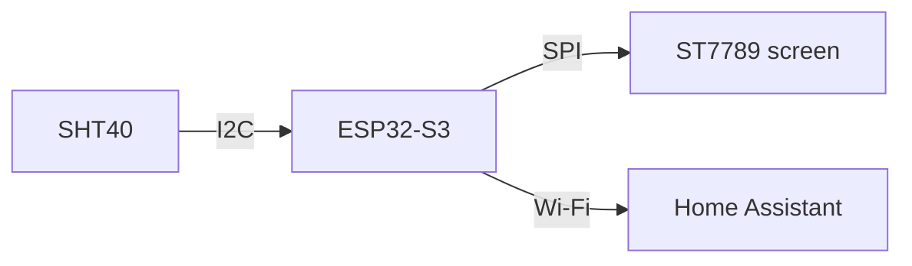
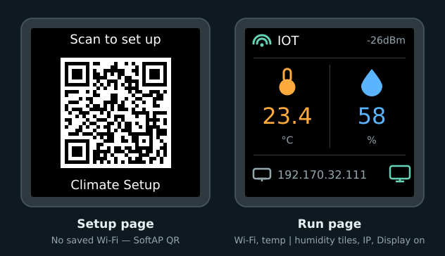

# ESP32-S3 HA climate

A small temperature and humidity sensor that behaves like something you bought: plug it in, scan the QR code on its screen, and it shows up in Home Assistant.

## What you'll end up with

- :lucide-thermometer: **Temperature and humidity**

    In Home Assistant, updated every 10 seconds.

- :lucide-monitor: **A live screen**

    240×240 colour display with Wi‑Fi status and climate tiles. Turn it off from Home Assistant with **Display**.

- :lucide-qr-code: **Setup from your phone**

    Scan the code, pick your Wi‑Fi, done.

- :lucide-save: **Settings that stick**

    Survive reboots and power cuts.

- :lucide-rotate-ccw: **Factory reset**

    Hold **BOOT** for 5 seconds to start setup again.

- :lucide-lock: **No Wi‑Fi password in the firmware**

    Not in the code and not in this repo.

## What the screen shows

*Mock-up from the firmware: SoftAP QR (no saved Wi‑Fi), then Wi‑Fi status, temp \| humidity tiles, IP, and Display-on cue.*

## Parts

| | Part | Notes |
|---|------|-------|
| :simple-espressif: | ESP32-S3 N16R8 dev board | 16 MB flash, 8 MB PSRAM, USB-C |
| :lucide-thermometer: | SHT40 breakout | Temperature and humidity over I2C |
| :lucide-monitor: | ST7789 240×240 display | Square 8-pin SPI module |
| :lucide-cable: | Breadboard and jumper wires | Any solderless breadboard |
| :lucide-usb: | USB-C **data** cable | Charge-only cables won't work |
| :brands-ubuntu:{ .lg .middle } | A computer running Ubuntu 24.04 | Builds and flashes the firmware |

## Tutorial

1. [Walk through the code](01-walkthrough/index.md)
2. [Build the image](02-build-image.md)
3. Wire and validate
4. Flash the ESP32
5. Configure and test

The whole firmware is one file: [`firmware/climate.yaml`](https://github.com/jajera/esp32-s3-ha-climate/blob/main/firmware/climate.yaml).
